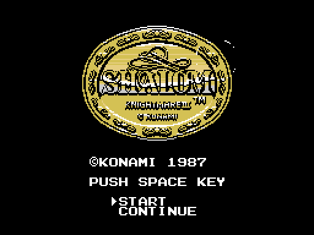
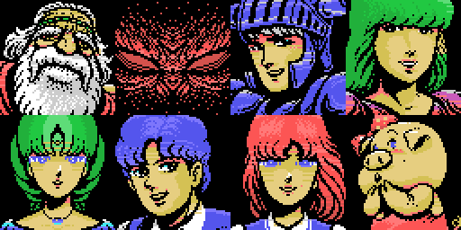
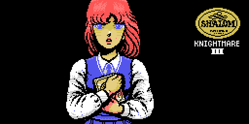
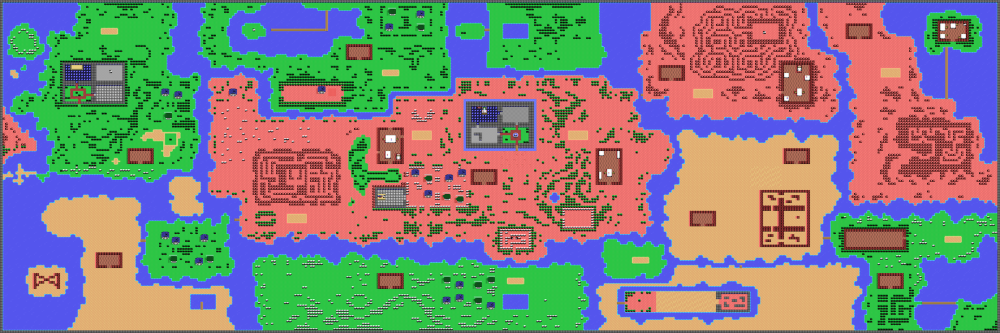
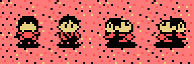
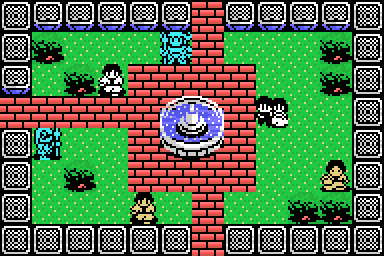
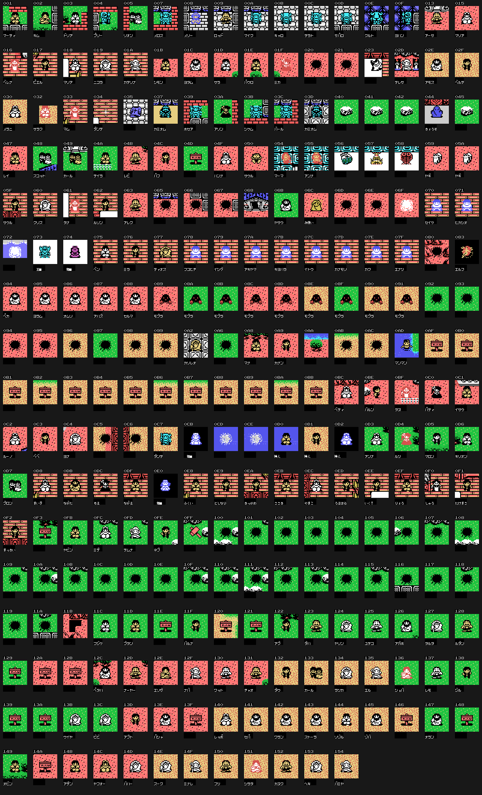
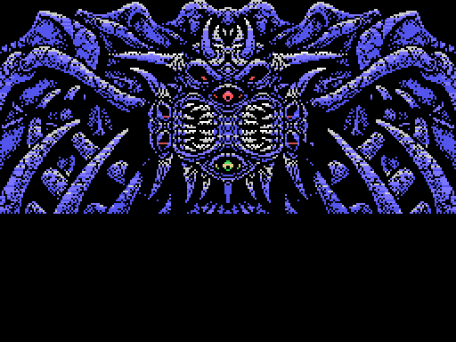
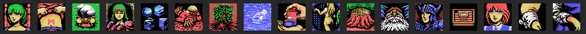
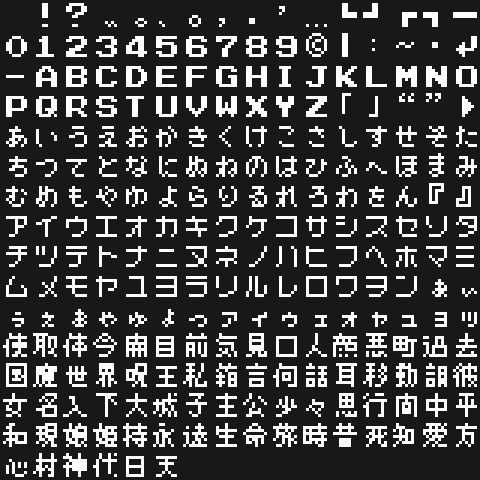

# The game

*Shalom: Knightmare III* (Konami, 1987, RC-754) is an MSX adventure in
Japanese: you explore a world of rooms, talk to people with a command menu and
fight in action scenes. Everything on this page comes from the cartridge's
tables; no picture is a capture.

## The title

The Konami logo (`p04:6527`, [picture](imagenes/rotulo.png)) and the title
screen (`p04:622B`): five graphics in two thirds, the flipped ones from
`p06:B255`, the font and the name rectangle from `p06:B5CA`.

## The story

Eight panels that appear one per page (`p04:6E03`). `historia_0` loads their
drawings with four RLE (`p04:7CB6`, `p04:7FFA`, `p05:81C0`, `p05:833E`) and
sets the colours to zero; each page uncovers one panel by copying its colours
with a wipe (list `p04:7C71`, `p00:4CD4`) and writes its text (`p04:6EDC`). The
panels stay: at the end all eight are shown.

The texts introduce the characters: the hero, the heroine, King Pampas,
Princess Chelsea, Popolon, Aphrodite, Butako and the great demon Gog. The story
sets "あなた" ("you") as the first name (`p04:6E5D`). Page by page:
[1](imagenes/historia_0.png), [2](imagenes/historia_1.png),
[3](imagenes/historia_2.png), [4](imagenes/historia_3.png),
[5](imagenes/historia_4.png), [6](imagenes/historia_5.png),
[7](imagenes/historia_6.png), [8](imagenes/historia_7.png).

## The opening scene

A conversation with options (`p04:6693`, 53 steps). Step 5 (`p04:671A`) builds
the heroine's face (the same colours as her panel in the story), a 12 x 8 tile
drawing and the frame with the emblem; the body only gets its colours if option
1 is chosen (`p04:678E`, wipe `p00:4D28`).

What is said are messages 0x02-0x2A of the table of room 0x200, with answer
tables per option (`p04:6873`, `p04:687B`, `p04:6883`).

## The world

The outside is a 32 x 16 grid of rooms (room = row x 32 + column): the table
`p02:858C` adds -0x20, +0x20, -1 or +1 when leaving by each side. Each room is
12 x 8 blocks of 16 x 16 in nibbles (`p00:514B`), with its tile set
(`p00:47C6`), its graphics (`p00:482F`) and the drawings that depend on the
story flags (`p09:60CC`).

[The outside at full size](imagenes/mundo.png). The rooms from 0x200 are linked
by hand in the code (`p02:859C`, `p02:8714`, `p02:88D4`; 0x228-0x22D at random
with `p02:8C83`): [the first dungeon](imagenes/mazmorra1.png),
[the second](imagenes/mazmorra2.png) and [all the rooms from 0x200 on their
own](imagenes/salas_especiales.png).

## Shalom

Three 16 x 16 sprites per frame (`p01:772A`); the frame is the direction plus
bit 4 of his frame count (`p01:7709`): the drawing changes every 16 frames.

## The characters in the rooms

Each room has its list (`p07:8BC2`): type, position and voice. Their two colours
and their name come from `p07:83B4`; the name is 4 letters from `p08:A063`.
They are drawn with two sprites using the drawings of `p07:97E8` and the
room's patterns (`p18:6A28`). The frame is set by each type's routine
(`p07:882D`), read one by one and checked by running its creation
(`tools/coteja_actores.py`): of 302 types checked, 300 match and the other 2
have not started walking yet.

[A room with its characters walking](imagenes/sala_21F_con_personajes.gif).
There are 325 types; those with colours 0/0 or no drawing are not shown. Three
(0x68, 0xAA and 0x11B) are not sprites: they put the 4 tiles of their frame in
their block (`p07:8705`).

## The action scenes and their bosses

Nine scenes (`p02:906E`). `p10:8C60` prepares them and `p00:4893` loads their
graphics; the rival is the object whose class equals the scene number and it
is painted with tiles on its first step. Scenes 2 and 4 only show the setting:
their boss puts no tiles.

All nine: [1](imagenes/accion_1.png), [2](imagenes/accion_2.png),
[3](imagenes/accion_3.png), [4](imagenes/accion_4.png),
[5](imagenes/accion_5.png), [6](imagenes/accion_6.png),
[7](imagenes/accion_7.png), [8](imagenes/accion_8.png),
[9](imagenes/accion_9.png).

Life (`0xE3F6`) starts at 0x14 (8 in scene 7 of the script); each hit takes 1
and gives 0x40 or 0x20 frames without damage. With item 11, the cloak, only one
hit in two counts (`p11:A7B8`). The bar is 10 cells, 13 in scene 4
(`p09:6B51`).

## The status panel

The box on the right shows one of 17 pictures (`0xE368`): the RLE of
`p12:733E` placed by `p09:6713`.

## The commands and the items

The table `p04:7A15` holds 94 names: 1 to 24 are the items you carry
(`0xE9D0`, bit 0); the rest are the menu commands.

- Items 1-12: たんけん, ローソク, みず, ゆびわ, はたけのき, てがみ, オノ, ダイヤ,
  フリーパス, ネックレス, マント, ハンマー. From 13 to 24 the table says あける.
- Some commands: 耳をすます, 目を開ける, 話しかける, 見る, 調べる, 取る, 使う,
  見せる, わたす, たたかう, にげる, パスワード.

Items are saved as bits of the game (`0xEB53-0xEB55`, `p03:BE63`).

## The texts

The 902 messages of each room's tables (`p21:639E`, `p21:64BA`) and the 94
options, taken out with the font table: 246 characters of 8 x 8 (`p04:6F39`)
with kana, digits, letters and 70 kanji. The voicing marks (dakuten) go on the
row above (`p00:4F1B`).

## Saving

- **Password** (bank 14): the 62 bytes of the game, a CRC-16 (polynomial
  `0xA001`) and a key; 130 letters.
- **Tape** (BIOS `00E1-00F0`), **disk** (BDOS) and **another cartridge** with
  "YZ" at `0x4010` (`p01:60CB`).

## The music

In [The music](THE-MUSIC.html): 42 pieces taken by running the bank 29 engine
and checked against openMSX.
